# Akses cetak dan transisi aplikasi

## Perilaku

Siapkan cetak tersedia di action bar presensi, berdampingan dengan unduhan BAP
per pertemuan, dan di dialog Dokumen BAP. Jika sesi yang sedang dibuka sudah
terkunci, sesi tersebut ditambahkan ke pilihan paket. Pertemuan terbuka tidak
dikunci otomatis dan tidak ikut dicetak. Draf, posisi pencarian, dan isian
presensi tetap ada ketika pengelola cetak dibuka atau ditutup.

Daftar pilihan paket dikelola di tingkat sesi aplikasi, sehingga dipakai bersama
oleh dashboard, presensi, dan dialog BAP. Pilihan tetap ada saat pindah halaman
atau menutup dialog. Pilihan ini berlaku selama sesi aplikasi; refresh/logout
meresetnya. Validasi status dan revisi paket di backend tetap berlaku.

Keluar dari dashboard sekarang meminta konfirmasi. Batal, Tutup, Escape, atau
klik latar membatalkan logout. Hanya Ya, keluar yang mengakhiri sesi lokal.
Token lokal dihapus; draf tersimpan dan cache tetap dipertahankan. Pemulihan dari
sesi kedaluwarsa tetap langsung menuju login, karena autentikasinya telah berakhir.

Saat login, aplikasi menampilkan simbol Lembar Centang dan indikator bergerak
selama verifikasi akses. Keberhasilan login cepat ditahan minimum 350 ms agar
transisi terbaca; password salah tetap menampilkan error dan mengembalikan fokus
ke field. Setelah autentikasi, loading menunggu data kelas/cache yang valid.
Jika penantian data awal mencapai delapan detik, pengguna mendapat pesan koneksi
dan akses Keluar, tanpa terjebak di splash. Akses ke data baru tetap menunggu
hasil query yang sebenarnya.

Perpindahan dashboard/presensi menggunakan skeleton minimum 220 ms pada koneksi
cepat. Pengelola cetak memakai 180 ms. Skeleton menunggu data bila query lambat.
Data reaktif setelah halaman terbuka memakai indikator tipis, tanpa mengganti
editor atau menghapus fokus/isian. Pencarian, filter lokal, dan ketukan status
tidak menyalakan skeleton halaman. Timer dibersihkan saat komponen berganti.

Shimmer, gerak simbol, dan transisi halaman menghormati reduced motion. Pada
preferensi tersebut, animasi dan penundaan dekoratif dihilangkan; penantian data
asli tetap berlaku. Sesi terkunci yang belum dicache dan dibuka offline tetap
menampilkan status belum dimuat, bukan semua Hadir atau skeleton tanpa jalan keluar.

Tidak ada perubahan API, autentikasi backend, skema, generator, atau template Word.

## Bukti tampilan

Versi sebelum berasal dari commit `8f5223516a6f605b2419b38549006bdcce53f500`.
Gambar memakai tema gelap dan fixture sintetis yang sama: HP 390 × 844 px dan
desktop 1280 × 900 px. Presensi menampilkan pertemuan 1 terkunci, semua Hadir,
serta dokumen siap. Login direkam selama verifikasi password contoh; perbandingan
logout menunjukkan dashboard sebelum klik dan konfirmasi setelah klik.

| Layar | Sebelum | Sesudah |
| --- | --- | --- |
| Presensi HP | 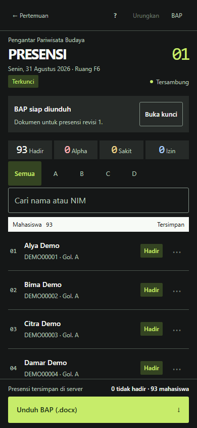 | 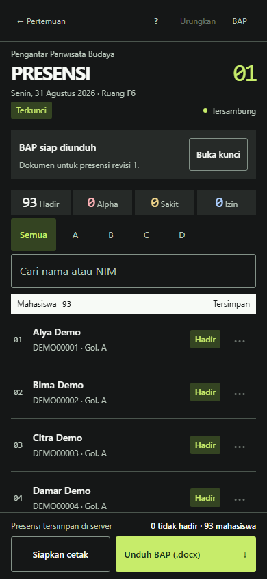 |
| Presensi desktop | 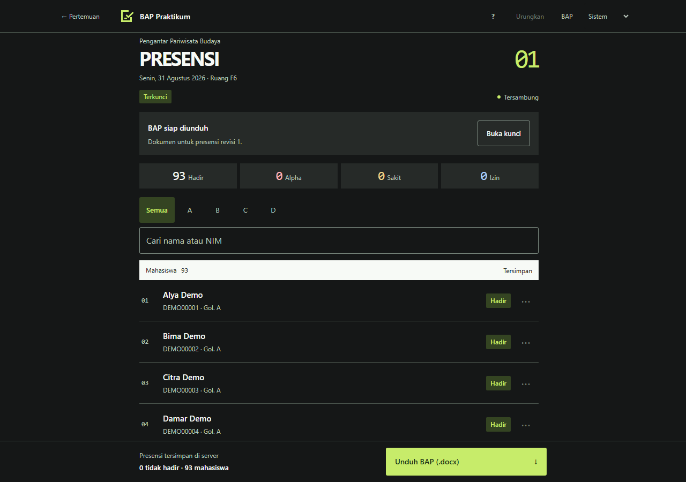 | 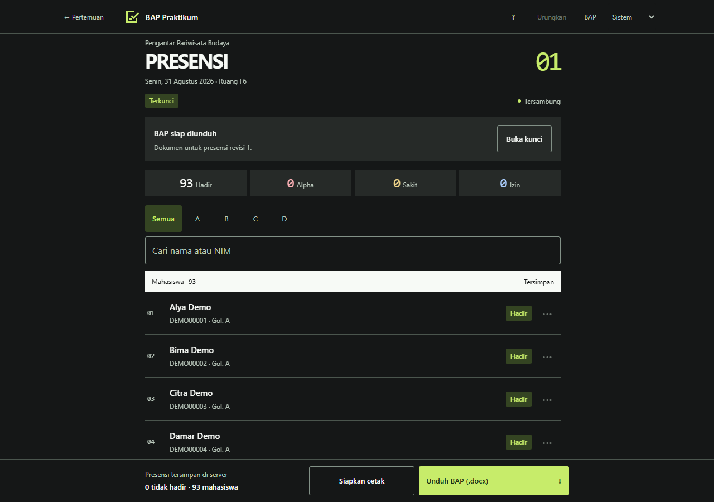 |
| Login HP | 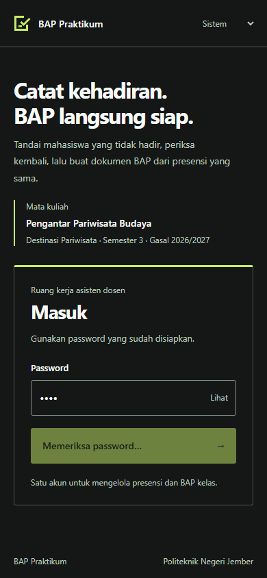 | 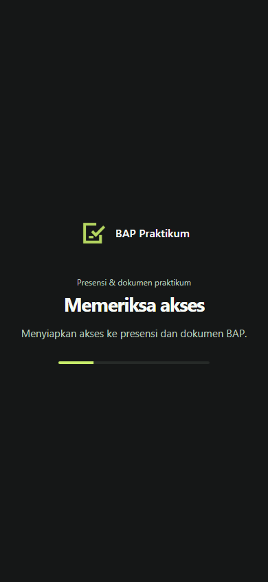 |
| Login desktop | 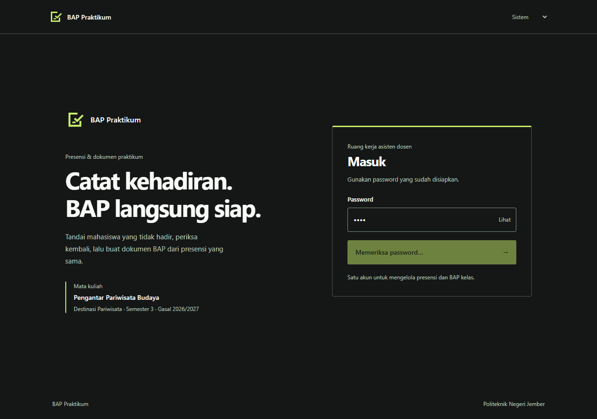 | 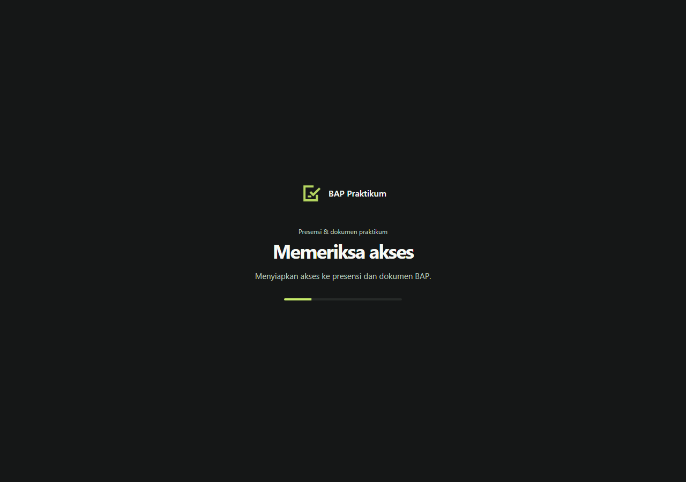 |
| Logout HP | 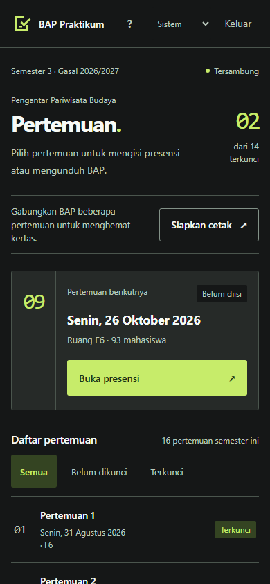 | 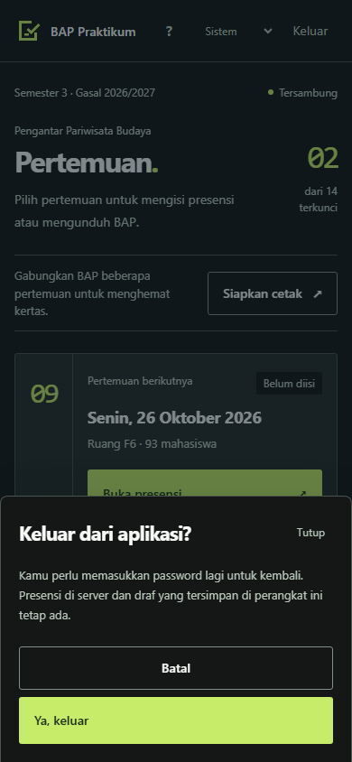 |
| Logout desktop | 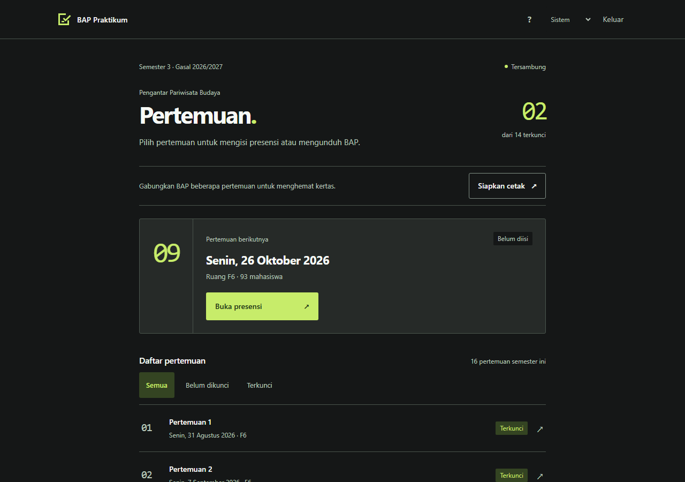 | 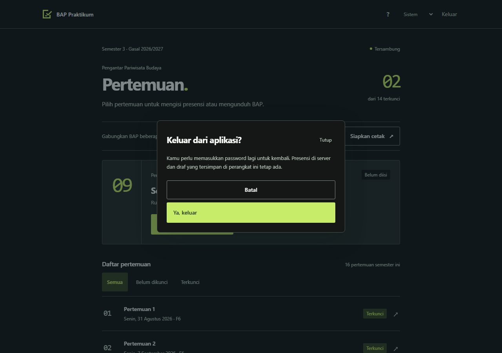 |

Pengelola cetak dari presensi: [HP](access-motion/quick-print-manager-mobile.png),
[desktop](access-motion/quick-print-manager-desktop.png).
Skeleton: [HP](access-motion/attendance-skeleton-mobile.png),
[desktop](access-motion/attendance-skeleton-desktop.png).

## Validasi

- `npm test`: seluruh logika, handler, wiring, storage, serta struktur DOCX tetap lulus.
- `npm run test:ui`: regresi pada enam lebar layar, dua tema, target sentuh 48 px,
  empat baris utuh di presensi terbuka 390 × 844, navigasi/dialog, simpan/BAP,
  offline, konflik, storage penuh, serta sesi kedaluwarsa.
- Tambahan uji: akses cetak dari footer dan dialog BAP tanpa dialog bertumpuk;
  sesi aktif terkunci dipilih; pilihan sama di dashboard; draf terbuka tidak ikut
  dicetak; draf/pencarian/fokus bertahan saat data server berubah.
- Konfirmasi logout diuji pada Batal, Escape, dan Ya, keluar; token/draf diperiksa.
- Query ditahan untuk membuktikan loading login dan skeleton menunggu data asli;
  penantian delapan detik menyediakan jalan keluar; reduced motion mematikan animasi.
- Membuka sesi terkunci yang belum dicache saat offline menampilkan status tidak
  diketahui dengan tombol simpan nonaktif dan navigasi kembali yang bekerja.
- Build produksi frontend lulus dengan URL placeholder. Fixture hanya ada di
  konfigurasi uji; screenshot tidak membaca roster atau kredensial asli.

Tes browser menggunakan Chromium. Safari/perangkat fisik belum diuji.
