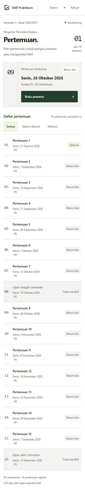
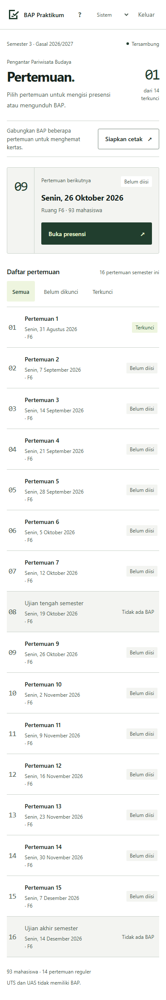
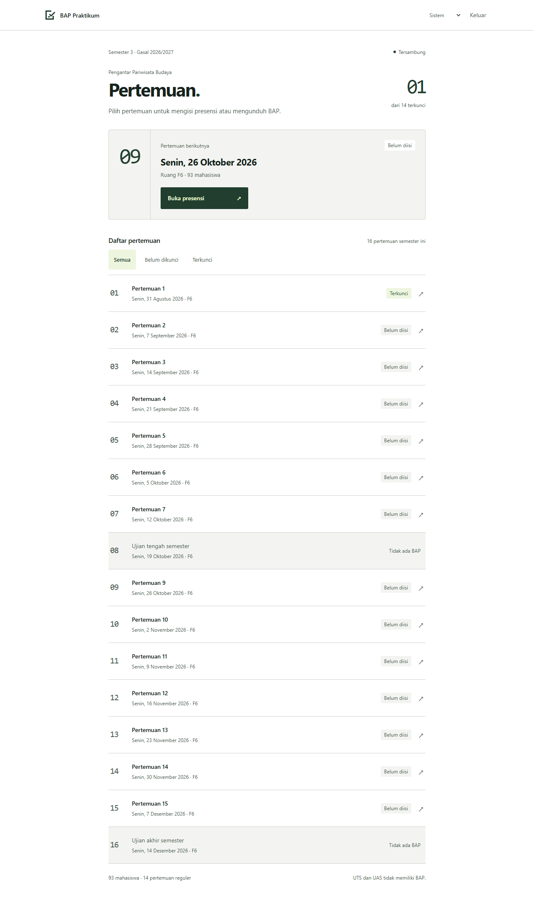
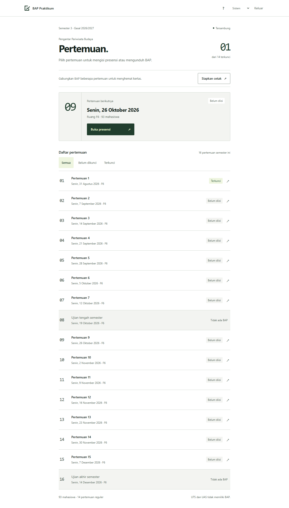

# Panduan awal dan paket cetak

## Panduan penggunaan

Setelah data kelas siap pada kunjungan pertama, aplikasi menampilkan tiga langkah:
pilih pertemuan, tandai yang tidak hadir, lalu periksa dan kunci. Pengguna dapat
memilih Lewati, Tutup, Escape, atau menyelesaikan panduan. Semua cara menutupnya
menandai panduan sudah dilihat. Panduan dapat dibuka lagi lewat Bantuan (?) pada
halaman pertemuan dan presensi, tanpa mengubah isian.

Penanda disimpan di browser, terpisah dari token dan draf. Logout tidak
menghapusnya. Browser/perangkat baru atau penghapusan penyimpanan browser akan
memunculkan panduan lagi. Jika storage tidak tersedia, penutupan tetap berlaku
selama kunjungan tersebut. Tidak ada onboarding yang menulis presensi contoh ke server.

## Paket cetak dua form per folio

Siapkan cetak tersedia di halaman pertemuan. Daftar pilihan hanya memuat
pertemuan reguler terkunci, menampilkan jumlah tidak hadir, jumlah form, dan revisi.
Pengguna memilih beberapa pertemuan, melihat rencana urutannya, lalu mengunduh
satu paket Word. Aplikasi tidak mengirim pekerjaan langsung ke printer.

Dokumen sumber yang diberikan pengguna berisi enam form pada tiga halaman,
dengan ukuran kertas sekitar 215 × 330 mm. Generator arsip sebelumnya memakai
satu form per halaman; ruang kosong bawah halaman memang berasal dari aturan itu.
Unduhan arsip per pertemuan tetap sama. Paket cetak menggunakan template prodi
yang telah dikoreksi dan menambahkan susunan dua form, tanpa mengambil data
presensi atau kesalahan tanggal dari dokumen sumber pengguna.

Setiap form menampung 12 ketidakhadiran. Form lanjutan berada setelah form utama,
dengan nomor 13, 25, dan seterusnya. Karena itu dua pertemuan tidak selalu berarti
dua form. Form ganjil menyisakan ruang kosong pada lembar terakhir. Rencana di UI
merupakan perkiraan; jika nama panjang membuat pasangan tidak muat, Word
memindahkan seluruh form ke halaman berikutnya. Tidak ada pemotongan tabel atau
pengecilan font otomatis. Paket memakai pembungkus tabel tanpa garis dengan baris
yang tidak boleh terpisah, dan padding khusus kolom nomor agar nomor lanjutan utuh.

Buka berkas di Word, periksa pratinjau, pilih kertas sesuai ukuran dokumen
(folio 215 × 330 mm), skala 100%, serta **1 halaman per lembar**. Jangan memilih
2 halaman per lembar lagi karena dua form sudah disusun dalam satu halaman.

## Konsistensi data

Satu query internal mengambil seluruh bahan paket dari satu snapshot, setelah
memvalidasi token, pilihan 1–14 pertemuan unik, tipe reguler, status terkunci, serta
revisi yang dipilih. Revisi basi atau sesi yang telah dibuka kuncinya ditolak.
Paket tidak mengubah presensi, tidak menambah arsip `bapDoc`, dan tidak menyimpan
file sementara di storage. Action mengirim berkas ke klien sebagai base64 untuk
diunduh melalui Blob. Hasil unduhan menampilkan revisi yang dipakai; koreksi
setelah snapshot memerlukan paket baru.

## Bukti sebelum dan sesudah

Sebelum: commit `acbbeb99bedf9dab54c3216827b8b75a0ddbe2bf`. Keduanya memakai
fixture sintetis yang sama (satu pertemuan terkunci), tema terang, viewport HP
390 × 844 dan desktop 1280 × 900, dengan screenshot halaman penuh.

| Layar | Sebelum | Sesudah |
| --- | --- | --- |
| Pertemuan HP |  |  |
| Pertemuan desktop |  |  |

Panduan: [HP](guide-print/guide-mobile.png).
Pilihan cetak: [HP](guide-print/print-mobile.png), [desktop](guide-print/print-desktop.png).
Output Word dua pertemuan: [satu folio](guide-print/word-two-meetings.png).
Nama panjang: [halaman 1](guide-print/word-long-names-page-1.png),
[halaman 2](guide-print/word-long-names-page-2.png).

## Validasi

- `npm test`: logika lama, 17 pemeriksaan handler termasuk autentikasi/revisi paket,
  wiring, storage, serta struktur DOCX pada 0/12/13/25/93 ketidakhadiran.
- `npm run test:ui`: Chromium dan fixture sintetis. Lewati/reload/buka ulang
  panduan; pilihan cetak terkunci; rencana dua form; gagal dan retry; unduhan tanpa
  popup; offline; serta seluruh regresi presensi dan enam ukuran layar/dua tema.
- Build frontend produksi dengan URL placeholder; fixture tidak masuk build.
- Renderer LibreOffice bawaan tidak tersedia pada host ini. Render dokumen
  dilakukan melalui Microsoft Word lokal dalam instance terpisah, lalu hasil PDF
  dirasterisasi dan diperiksa. Sumber asli: tiga halaman, dua form masing-masing.
  Paket sintetis: dua pertemuan normal satu halaman; kasus 13 dan 25 ketidakhadiran
  dua halaman (2 + 1 form); satu form tetap satu halaman; dua form berisi 12 nama
  panjang masing-masing dua halaman utuh (1 + 1 form).

Tidak ada fixture atau screenshot yang membaca roster asli. Login/action baru ke
backend produksi dan hasil cetak di perangkat fisik belum diuji. Pratinjau Word
menjadi pemeriksaan akhir karena engine layout/perangkat printer dapat berbeda.
