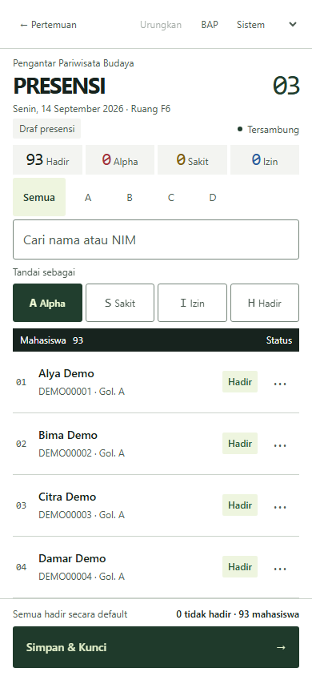
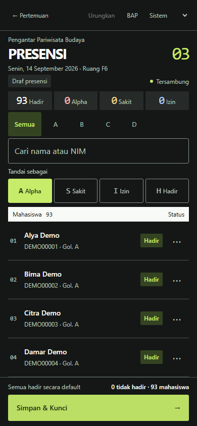
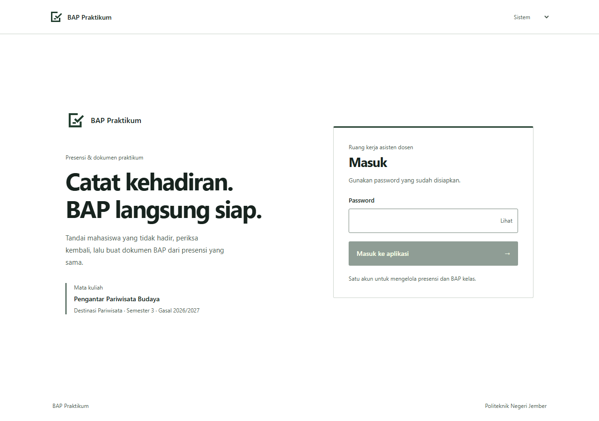
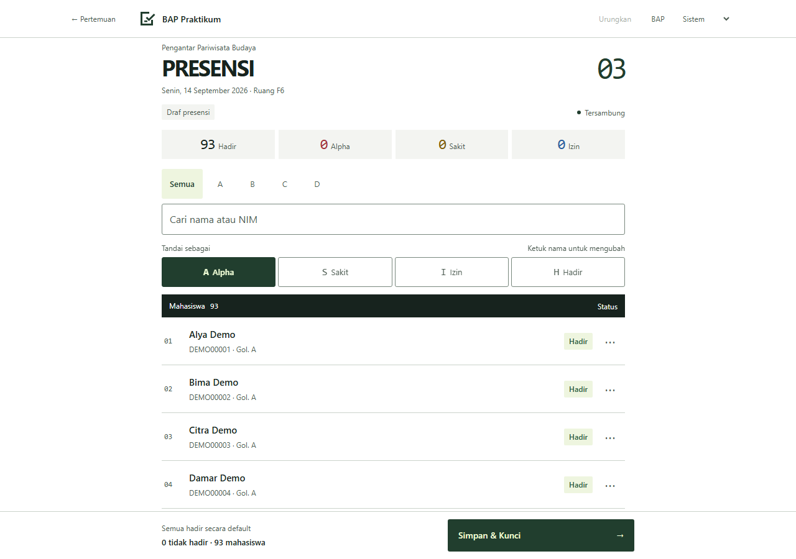

# Pembaruan UI Kontras

20 Oktober 2026

## Perubahan

Login, daftar pertemuan, dan presensi memakai arah Kontras: bidang datar, sudut kecil, angka monospace, serta tema terang/gelap. Simbol Lembar Centang dipakai pada header dan favicon. Semua aksi utama mempunyai target sentuh minimum 48 px.

Presensi menampilkan nama dan NIM, pencarian keduanya, counter empat status, filter golongan, mode kuas, undo, dan sheet per nama. Review sebelum menyimpan menampilkan daftar mahasiswa tidak hadir. Daftar pertemuan menampilkan 16 sesi termasuk UTS/UAS yang tidak dapat dibuka.

Keadaan draf lokal, menunggu server, terkunci, proses BAP, BAP siap, dan gagal unduh dibedakan. BAP diunduh sebagai Blob dengan nama `.docx`, tanpa membuka tab baru. Perubahan revisi server tidak menghapus draf secara reaktif. Detail sesi dicache agar presensi yang sudah dibuka bisa ditampilkan lagi tanpa menunggu query baru.

Skema, autentikasi server, transaksi, template, dan generator Word tidak diubah.

Preview Vercel pertama gagal sebelum frontend dibangun karena `convex codegen`
terpisah tidak mendukung preview deploy key. Helper runtime resmi
`convex/_generated/api.js` sekarang di-commit (tanpa data atau kredensial), lalu
build menjalankan `convex deploy --cmd 'npm run build'` langsung setelah embed
peserta. Pengaturan akun, key, dan data production tidak diubah.

## Bukti tampilan

Gambar dan seluruh fixture pengujian memakai nama serta NIM **sintetis**. Pengujian tidak membaca roster asli atau seed yang dihasilkan deployment. Status kehadiran bukan catatan kelas sebenarnya.

### Presensi HP





### Desktop





Daftar pertemuan: [gambar desktop](ui-preview/pertemuan-desktop.png).

## Verifikasi

- `npm test`: 8 pemeriksaan logika BAP/tanggal, 14 pemeriksaan handler, wiring API, dan regresi helper UI/storage.
- Build produksi frontend berhasil memakai referensi API dari template codegen Convex yang terpasang. Untuk pemeriksaan lokal ini URL Convex berupa placeholder; tidak ada deployment yang diubah.
- `npm run test:ui`: Chromium headless dengan API fixture lokal; tidak perlu login Convex atau file generated untuk harness ini.
- Enam lebar 320/360/390/414/768/1280 px, masing-masing tema terang dan gelap: tidak ada overflow halaman; kontrol aktif minimum 48 × 48 px.
- Empat baris nama utuh pada 390 × 844 px.
- Login salah/benar, tampilkan password, 16 pertemuan, dan UTS/UAS nonaktif.
- Mode kuas, undo, pencarian NIM, counter kelas penuh ketika difilter, navigasi nama, keyboard dialog, serta review sebelum kunci.
- Simpan berhasil lalu generator gagal: sesi tetap terkunci. Retry berhasil. Unduh memberi filename yang benar tanpa popup. Buka kunci dapat dipakai untuk koreksi.
- Cache/draf bertahan saat pindah layar dan reload harness tanpa query; sambung ulang tidak mengganti perubahan lokal.
- Konflik revisi mempertahankan draf dan base revision; muat server mencadangkan draf lama.
- Storage penuh menampilkan peringatan dan melindungi navigasi keluar; teks 200% tidak membuat overflow halaman.
- Sesi kedaluwarsa mempunyai pemulihan ke login tanpa menghapus draf yang tersimpan.

Pengujian browser memakai fixture untuk menjaga data produksi. Login, mutation, generate, dan unduh terhadap deployment Convex sungguhan belum diuji dengan kredensial operator. Verifikasi perangkat fisik/Safari tetap perlu dilakukan sebelum penggunaan kelas; pemeriksaan di atas menggunakan Chromium.

## Menjalankan ulang uji UI

```sh
npm ci
npx playwright install chromium
npm test
npm run test:ui
```

Harness membuat server lokal pada port 5184 dan menutupnya setelah selesai. Screenshot hasil uji ditulis ke `out/ui-qa/`; tidak mengubah gambar yang sudah direview. Untuk memperbarui gambar dokumentasi dengan sengaja, jalankan dengan environment `BAP_UPDATE_UI_PREVIEWS=1`.

Alias fixture hanya ada dalam `scripts/ui/vite.config.mjs`. `vite.config.js` produksi tetap memakai Convex yang sebenarnya.
