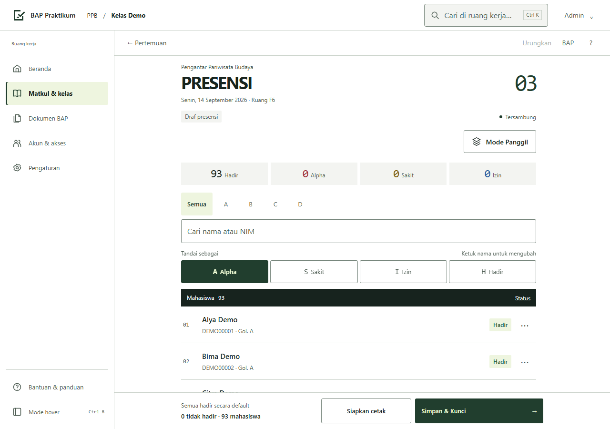
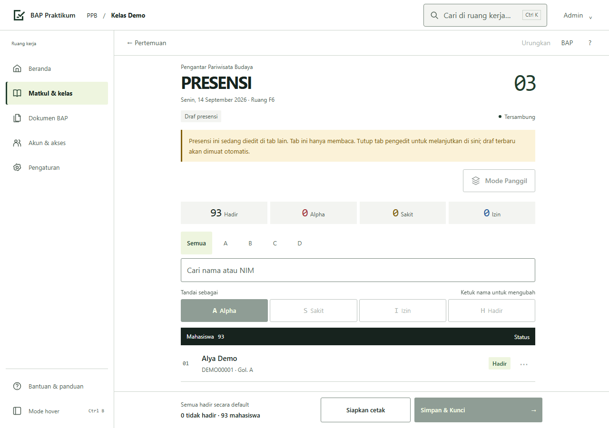
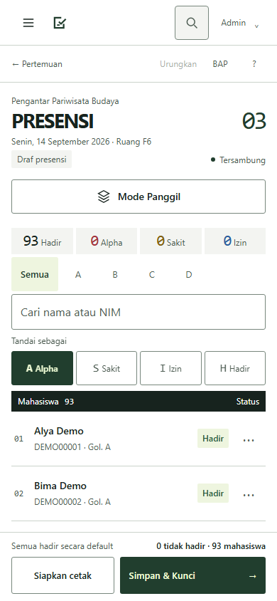
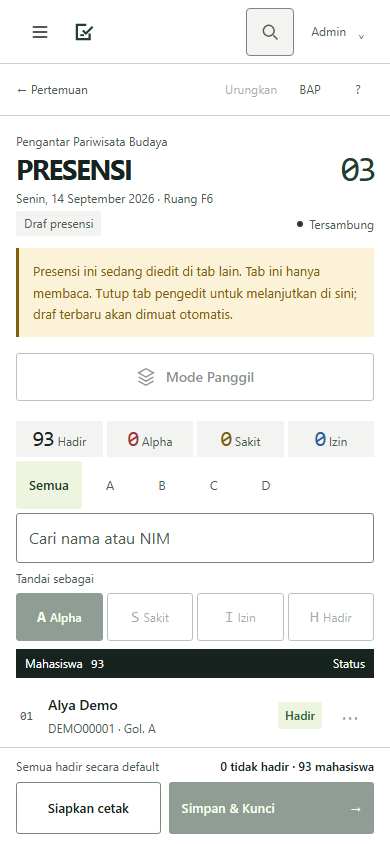
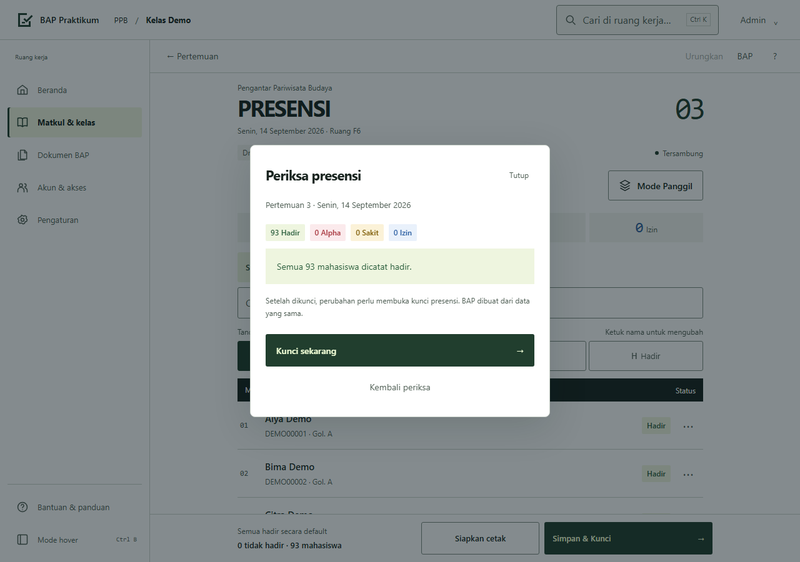
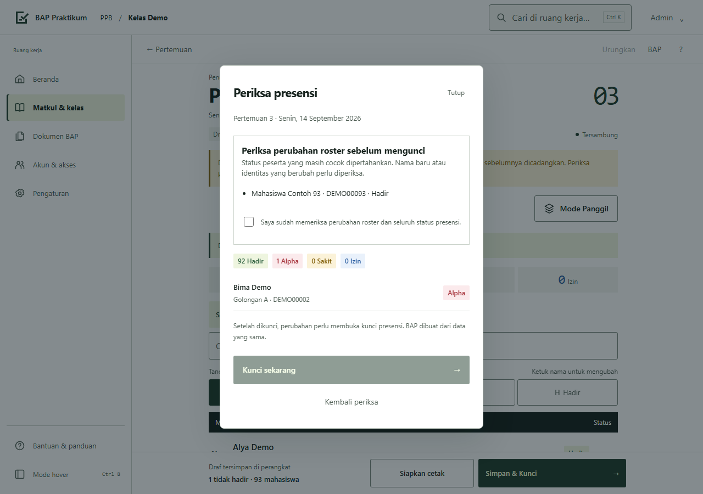
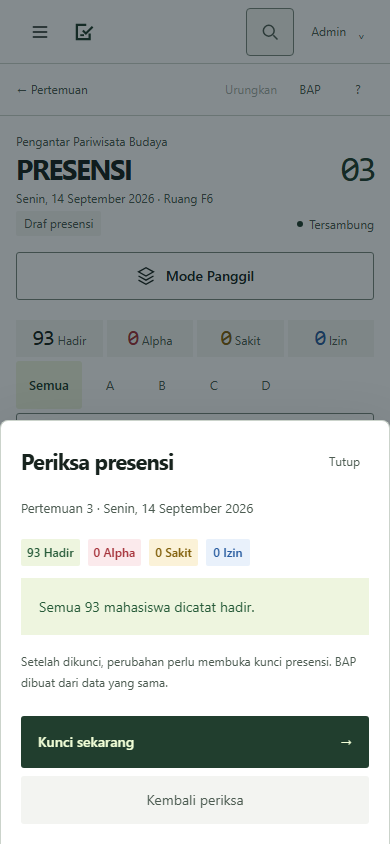
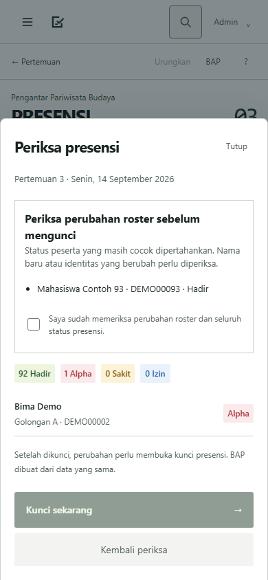

# Bukti audit fungsi

Base aktual: `5bd0d6f650c419a2c1486d0c79817147fce98c48` (main).
Before dirender dari `git archive` commit tersebut, memakai aplikasi asli dan
transport fixture sintetisnya. After memakai branch perbaikan. Chromium,
light theme, reduced motion, 1280×900 dan 390×844, data yang sama.
Tidak ada roster, NIM atau kredensial produksi pada gambar.

| Skenario | Before | After |
| --- | --- | --- |
| Tab kedua desktop: 93 mahasiswa, belum diedit |  |  |
| Tab kedua mobile: input sama |  |  |
| Review desktop: roster server 93; draf 92; Bima Alpha |  |  |
| Review mobile: input sama |  |  |

Before review mengabaikan seluruh draf dan menampilkan 93 Hadir. After
mempertahankan Alpha serta memerlukan pemeriksaan nama baru sebelum lock.
Tab kedua berubah menjadi read-only; handoff dan pemulihan draf diverifikasi
oleh tes browser, bukan hanya gambar.

Screenshot keadaan normal sebelum/sesudah identik byte demi byte untuk kedua
viewport; SHA-256 ada pada `normal-hashes.json`. CSS, font, warna dan susunan
layar normal tetap sama. Rencana UI/UX U01–U08 masih menunggu review.

- `captures.json`: viewport, commit base, input dan hasil capture.
- `verification.json`: 17 pemeriksaan final lulus dengan fingerprint source
  konsisten sebelum/sesudah verifikasi.
- [Rincian implementasi, rollout dan batas bukti](../AUDIT-FUNCTIONAL-FIXES.md).
