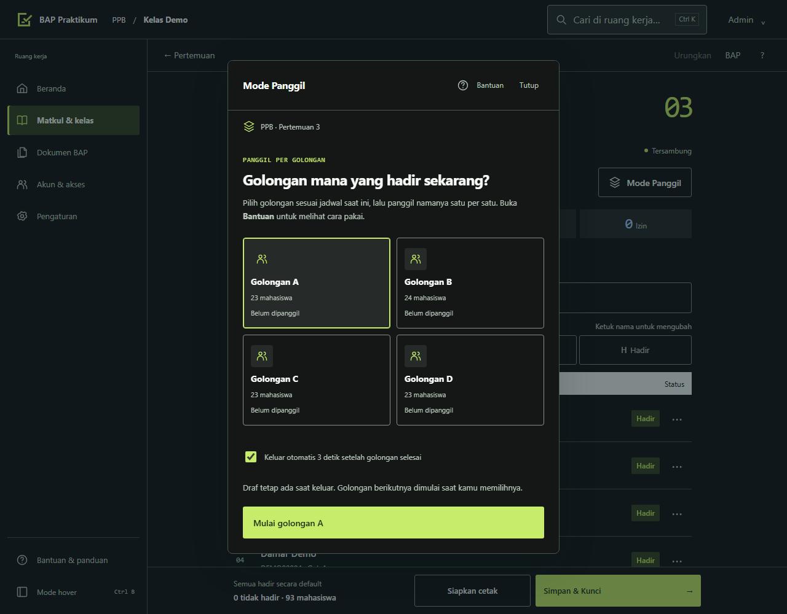
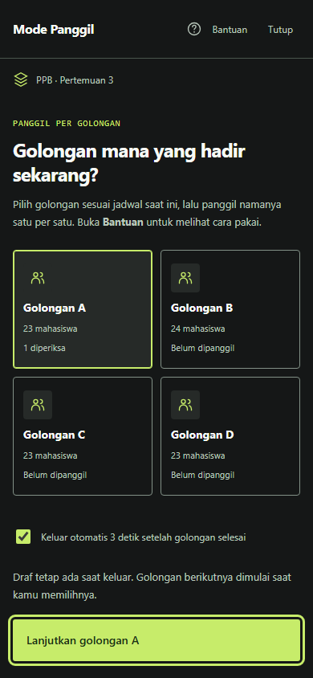
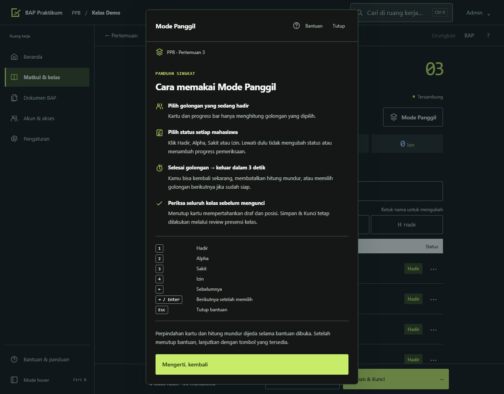
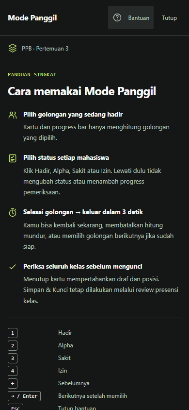
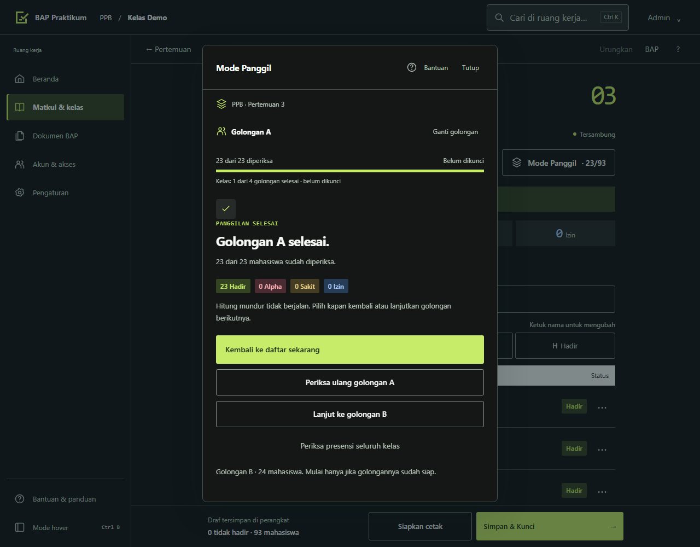
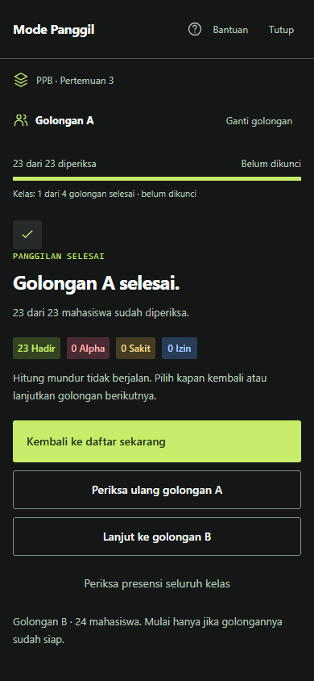

# Bukti UI Mode Panggil

Base: `56e8b5eecd751e80ff697cebf5a1d077a3394581` (merge sidebar PR #8).
Sumber sebelum diekstrak langsung dari commit base oleh `git archive`, bukan
merekonstruksi tampilan lama lewat CSS pada kode sesudah.

Data: roster sintetis 93 mahasiswa, pertemuan 3, seluruhnya Hadir pada perbandingan
daftar. Tema gelap; desktop 1280 × 1000 px dan HP 390 × 844 px. Gambar kartu
terpisah menampilkan contoh pilihan Izin untuk nama pertama.

```sh
node scripts/ui/panggil.cjs --capture-only
```

| Layar | Sebelum | Sesudah |
| --- | --- | --- |
| Daftar desktop |  |  |
| Daftar HP |  |  |


| Alur per golongan | Desktop | HP |
| --- | --- | --- |
| Pilihan dengan ikon |  |  |
| Bantuan di popup |  |  |
| Hasil setelah countdown dibatalkan |  |  |

`results.json` adalah ringkasan 22 kelompok UI kartu yang lulus (11 per browser,
Chromium dan WebKit). Rincian cakupan serta batas verifikasi ada di
[`../MODE-PANGGIL.md`](../MODE-PANGGIL.md). Tes UI backend QA nyata terpisah lulus
24 kelompok, failure injection 6 kelompok, renderer PDF 2 browser dan responsif
layout kelas 144 kombinasi viewport/tema. Tes helper dan build juga lulus.
